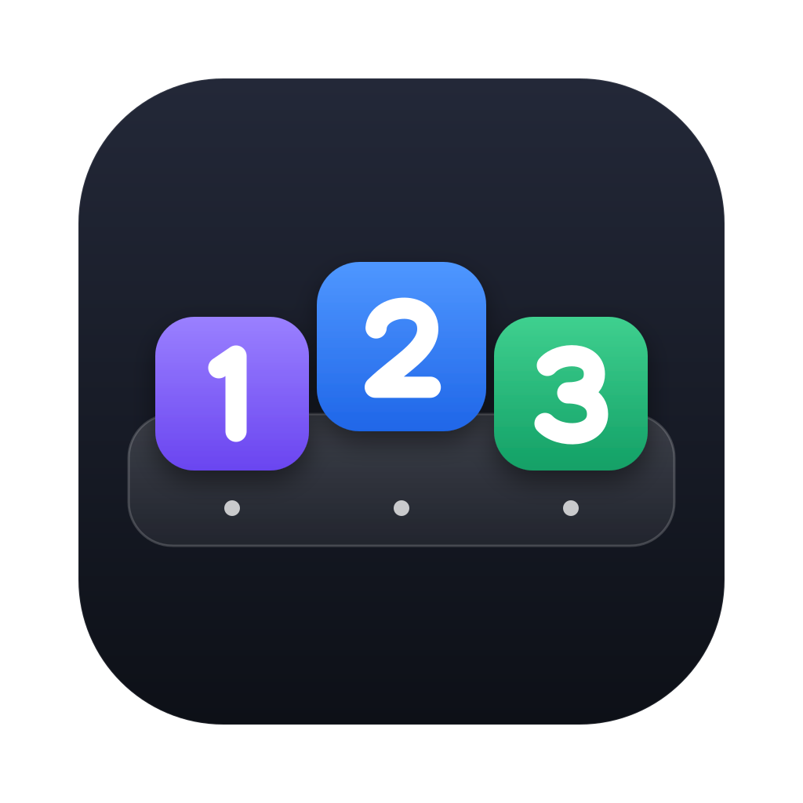

<p align="center">
  
</p>

<h1 align="center">Seatbay</h1>

<p align="center">
  <strong>Every Claude account in its own seat.</strong><br>
  Run several Claude Desktop apps side by side on one Mac, each signed in to a different account
  (or connected to an API key), each with its own coloured, numbered Dock icon.
</p>

<p align="center">
  <a href="https://github.com/Hitesh-Sisara/seatbay/actions/workflows/ci.yml"></a>
  <a href="https://github.com/Hitesh-Sisara/seatbay/releases/latest"></a>
  <a href="LICENSE"></a>
  
</p>

<p align="center">
  <a href="https://seatbay.sisara.in">Website</a> ·
  <a href="https://github.com/Hitesh-Sisara/seatbay/releases/latest/download/Seatbay.zip">Download</a> ·
  <a href="https://seatbay.sisara.in/docs">Docs</a> ·
  <a href="CHANGELOG.md">Changelog</a>
</p>

---

Claude Desktop signs in to one account at a time. Seatbay gives each extra account its own small
app in `~/Applications`: open it and you get a separate Claude window with its own sign-in, chats,
settings, MCP servers and Claude Code sessions, running next to your regular Claude. It's free, open
source, has no telemetry and needs no account.

> Seatbay is an independent project and is not affiliated with or endorsed by Anthropic.
> "Claude" is a trademark of Anthropic, PBC.

## Features

- **Side by side, for real.** Every instance runs at the same time as the others. Clicking the
  regular Claude icon still opens your main Claude, not an instance.
- **A Dock icon you can tell apart.** Each instance gets Claude's icon in its own colour, with a
  number badge, an optional label strip such as `WORK`, and an `API` tag for API instances.
- **Sign in without quitting everything.** **Sign In…** sends the browser's sign-in link to the
  instance you're signing in, while the others keep running.
- **Accounts or API keys.** An instance can use a Claude account, Anthropic's API, or any
  Anthropic-compatible gateway (base URL, `x-api-key` or Bearer, model list, extra headers).
- **Backups you don't have to think about.** Each Claude is backed up when it quits and every
  night between 2 and 3 AM, open ones included, without closing anything. A missed night is
  caught up when the Mac wakes. Uploads to any S3-compatible storage (AWS S3, Cloudflare R2,
  Backblaze B2, Wasabi, MinIO) are encrypted on your Mac first. Restore, or restore as a new
  instance.
- **Safe updates (opt-in).** Checks Anthropic's signature on a downloaded Claude update, closes
  every Claude, backs each one up, installs, and reopens exactly what was open. Roll back if needed.
- **Health and sleep.** Memory, CPU and sign-in state per Claude; quit instances that sit idle.
- **A second Mac.** Copy Seatbay and your instance profiles to another Mac over SSH.
- **Bypass permissions by default** for Claude Code sessions in every Claude, with a clear warning.
- **Scriptable.** Everything the window does is available from the command line.

## Install

1. Download [Seatbay.zip](https://github.com/Hitesh-Sisara/seatbay/releases/latest/download/Seatbay.zip)
   from the latest release, unzip it and move **Seatbay.app** to **Applications**.
2. **First open:** the app is open source and ad-hoc signed, not notarized by Apple, so macOS asks
   before opening it the first time. Right-click **Seatbay.app → Open**, then **Open**. (Or, in
   Terminal: `xattr -dr com.apple.quarantine /Applications/Seatbay.app`.) You can check the
   download against `Seatbay.zip.sha256` on the release page.
3. You need macOS 14 or later and Claude Desktop in `/Applications`
   ([download Claude](https://claude.ai/download)). Apple silicon and Intel are both supported.

### Build from source

```bash
git clone https://github.com/Hitesh-Sisara/seatbay.git
cd seatbay
./scripts/build.sh --install     # builds build/Seatbay.app and copies it to ~/Applications
```

You need Xcode 16 or later (or its command-line tools with Swift 5.10+). `swift test` runs the
unit tests.

## Using it

Open **Seatbay** and click **New Instance**. Choose a name, number, colour, icon style and an
optional label, pick **Connect with: Claude account** or **API key**, and click **Create**. You get
`~/Applications/<Name>.app`; open it from Seatbay, Spotlight, Raycast or Alfred, or pin it to the
Dock.

**Signing in.** Click **Sign In…** next to an instance, then sign in as usual. The browser's
`claude://` link goes to that instance only.

**API instances.** Leave **Base URL** blank for Anthropic's API, or enter an Anthropic-compatible
gateway (the address Claude adds `/v1/messages` to). Enter the key and how the gateway expects it
(`x-api-key` or `Authorization: Bearer`), and optionally model ids for the model menu and extra
headers. **Test Connection** asks the API for its model list, which costs no tokens. The first time
the instance starts, Claude encrypts ("seals") the key with your keychain.

**Backups.** Seatbay asks once whether to turn on nightly backups. Add S3-compatible storage in the
**Backups** tab to keep an encrypted copy off your Mac: endpoint, bucket, keys and a passphrase
(typed twice). Keep the passphrase somewhere safe; without it the uploaded backups can't be
restored.

## How it works

Each instance is a tiny app bundle (about 200 KB) that Seatbay generates:

```
~/Applications/Claude Work.app
  Contents/Info.plist        own name, bundle id and icon; SBDataDir = its data folder
  Contents/MacOS/launcher    seatbay-launcher
  Contents/Resources/AppIcon.icns
```

When you open it, the launcher makes a private copy of the installed `/Applications/Claude.app`,
gives the copy the instance's icon, and starts Claude from that copy with
`--user-data-dir=~/Library/Application Support/Seatbay/Instances/<id>`.

- **Its own copy of Claude.** macOS tells running apps apart by the path they run from. If every
  instance ran `/Applications/Claude.app` itself, clicking the regular Claude icon would bring an
  instance forward instead of opening your main Claude. So each instance runs from
  `~/Library/Application Support/Seatbay/Runtime.noindex/<id>/<Name>.app`. The copy is an APFS
  clone: about 0.2 seconds and no extra disk space. It's made fresh on every launch, so it is always
  the installed version, and it is never patched or re-signed, so the code signature and keychain
  access stay Claude's own.
- **Clean-up.** A small helper waits for the instance to quit, deletes the copy and leaves a link to
  the instance app at its path, so a Dock or macOS reference to that path still opens the instance.
- **Data separation.** Electron's `--user-data-dir` moves everything (cookies and sign-in, local
  storage, settings, Cowork and Code sessions) into the instance's folder. Your main Claude keeps
  using `~/Library/Application Support/Claude` (or `Claude-3p` with an API key or cloud provider).
- **API instances.** Claude Desktop reads third-party inference settings from `configLibrary/` in a
  data folder whose name ends in `-3p`. An API instance's folder is `Instances/<id>-3p`, and
  Seatbay writes the `configLibrary` entry the way Claude's own setup window does. Switching an
  instance between an account and an API key keeps both folders, so switching back finds the old
  sign-in or settings and history again.
- **No duplicates.** If an instance is already running, opening its app brings its window forward.
- **What is running.** Seatbay reads this from the process table (each Claude's path and
  `--user-data-dir`), not from the list of open apps, which on some macOS versions lists an
  instance without a process id.
- **Sign-in relay.** Google and email sign-in finish with the browser opening a `claude://` link,
  which macOS hands to the main Claude. **Sign In…** makes Seatbay the `claude://` handler for a
  moment, sends the link to the chosen instance as a standard "open URL" Apple Event, then gives
  `claude://` back to Claude. macOS asks once to allow "Seatbay" to control "Claude".

## Updates

Only your regular Claude looks for updates and installs them. Instances have update checks turned
off and start from the installed version each time they open; after an update, an instance that is
still open keeps the earlier version until you restart it (Health shows which).

**Safe updates** (Updates tab, off by default) does the whole round: it checks that the downloaded
update is signed by Anthropic, closes every Claude, backs each one up, runs Claude's own installer,
and reopens what was open. It can run by itself while you're away, and keeps the previous version
for **Roll Back**. **Restart All** does the same round without installing anything.

## Backups

A backup is a `tar.gz` of one Claude's data folder without caches and things that download again
(`Cache`, `Code Cache`, GPU caches, `Logs`, `vm_bundles`, `claude-code`, …). It holds the sign-in,
settings and local session data, usually a few MB.

- **On quit and on demand:** each time a Claude quits (at most once every 6 hours per Claude), during
  a safe update, when an instance is put to sleep, and with **Back Up Now**. These are taken while
  that Claude is closed, the cleanest kind.
- **Nightly (once you turn it on):** between 2 and 3 AM (pick the hour), every Claude that changed
  since its last backup, including open ones: their folder is cloned first and the clone archived,
  so nothing is closed. Then every backup not yet in S3 is uploaded, which also retries uploads that
  failed earlier. A launchd agent (`~/Library/LaunchAgents/in.sisara.seatbay.backup.plist`) runs it,
  so Seatbay doesn't have to be open. If the Mac was asleep or off, or the round failed, it runs when
  the Mac is awake and retries every 30 minutes until it succeeds; Seatbay warns you after 36 hours
  without a complete round. **Back Up Everything Now** runs the round at once.
- **Where:** `~/Library/Application Support/Seatbay/Snapshots`, the last 10 per Claude.
- **Restore:** pick a backup in the Backups tab. The current folder is backed up first and then moved
  to the Trash, so a restore can be undone.
- **S3-compatible storage (optional):** AWS S3, Cloudflare R2, Backblaze B2, Wasabi, MinIO and
  similar. Each backup is encrypted on your Mac (AES-256-GCM, key from your passphrase with
  PBKDF2-HMAC-SHA256, 600,000 rounds, random salt per file) before upload, and can be restored on
  another Mac with the same passphrase. Each Mac uploads to its own folder. The access key and
  passphrase are stored in a `0600` file, `secrets.json`, not in the Keychain.

A backup contains sign-in data. Treat the Snapshots folder and the bucket like passwords.

## Bypass permissions by default

The **Start new Code sessions in Bypass permissions** switch (under Options) sets
`permissions.defaultMode: "bypassPermissions"` in `~/.claude/settings.json`, after asking you to
confirm. Claude Desktop has no launch flag for its default permission mode; it reads that key from
the Claude Code settings files, so the switch covers the main Claude, every instance and the
terminal `claude` CLI. The edit keeps every other setting and the file's key order (it re-indents
with two spaces), writes through a symlinked file, and saves a one-time copy as
`settings.json.seatbay-backup` first.

Each Claude app also has its own **Settings → Claude Code → Allow bypass permissions mode**, stored
per account. Seatbay never flips that security switch for you.

## Command line

```bash
S="/Applications/Seatbay.app/Contents/MacOS/Seatbay"
"$S" --create-instance "Claude Work" Blue 2 WORK   # name, colour, number, optional label
"$S" --list
"$S" --health                                       # one line per Claude: state, memory, CPU, sign-in
"$S" --bypass-default on                            # or off / status
"$S" --backup all                                   # or main / an instance name; --force skips the 6-hour rule
"$S" --backup-round                                 # the nightly round now: every Claude, then upload
"$S" --backup-schedule status                       # or on / off / hour 2 / install
"$S" --list-backups
"$S" --restore-snapshot <snapshot id> <main|name>
"$S" --configure-s3 < s3.json                       # endpoint, region, bucket, prefix, keys, passphrase
"$S" --s3-test                                      # also --s3-list, --s3-upload <id> [name], --s3-download <key> <file>
"$S" --configure-api "Claude Work" < api.json       # {"baseURL","apiKey","authScheme":"x-api-key|bearer","models":[],"headers":{}}
"$S" --configure-api "Claude Work" account          # back to a Claude account
"$S" --api-status "Claude Work"                     # also --api-test
"$S" --update-status
"$S" --update-all                                   # the safe-update round; --restart-all does it without an update
"$S" --restart-all --only "Claude Work,Claude Dev"  # restarts just those; a waiting update stays for a full round
"$S" --other-mac-status user@host
"$S" --copy-profiles user@host all                  # or "Name,Name"
"$S" --import-profiles profiles.json
open -a Seatbay --args --sign-in "Claude Work"
```

Colours: Blue, Green, Purple, Pink, Teal, Red, Amber, Indigo, Brown, Graphite, Black, Orange.

## Known limits

- **After a power loss or a macOS crash.** The clean-up helper can't run, so an instance's copy of
  Claude stays on disk. If macOS reopens that copy at login, it starts without the instance's data
  folder. While Seatbay is open it closes such a stray copy and opens the instance properly.
- **Updates inside an instance.** "Check for Updates…" in an instance reports an error, because
  update checks are off there. Update from the regular Claude or the Updates tab.
- **Pin instances from `~/Applications`.** Drag the instance app to the Dock. "Keep in Dock" on a
  running instance stores the path of its temporary copy; it still opens the instance, but the Dock
  tile may not show the right icon.
- **The name "Claude".** The Dock icon is the instance's own, but the menu bar, Force Quit and
  Activity Monitor still say "Claude".
- **A different disk.** The private copy needs Claude.app and your home folder on the same APFS
  volume (the normal setup). Otherwise the instance runs Claude.app directly.
- **Privacy permissions.** Microphone, folders and similar permissions may be asked per instance.
  Instance apps are ad-hoc signed, so when Seatbay rebuilds one (after changing its icon, or after
  Seatbay is updated) macOS can ask again.
- **API keys are tied to this Mac.** A key Claude has sealed only works with this Mac's keychain. A
  backup restored on another Mac, or a profile copied there, needs the key entered again.
- **Backups while open** are like the folder after a power cut, which Claude recovers from; the
  session running at that moment may lose its last few seconds if you restore one.
- **Asleep at 2 AM.** macOS doesn't wake a sleeping Mac for the backup; it runs when the Mac wakes.
  The first time the agent is installed, macOS shows a "Background Items Added" notice.
- **Uploads over 4.5 GB** stay on the Mac (a single upload is limited to 5 GB). Backups are normally
  a few MB.

## Uninstall

1. In Seatbay, turn off nightly backups (or run `"$S" --backup-schedule off`), which removes the
   launchd agent.
2. Delete instances with **⋯ → Delete…** (choose whether to keep their data), or delete their apps
   from `~/Applications`.
3. Quit Seatbay and move `Seatbay.app` to the Trash. To remove everything, also delete
   `~/Library/Application Support/Seatbay` (instance data and backups).

## Upgrading from Multi Claude

Seatbay was called Multi Claude before its first public release. Installs from that time keep their
data where it is (`~/Library/Application Support/MultiClaude`); Seatbay finds it, rebuilds the
instance apps with the new launcher, replaces the old backup agent, and keeps uploading to the same
S3 folder. Delete the old `Multi Claude.app` after installing Seatbay.

## Files

| Path | What |
| --- | --- |
| `~/Applications/<Name>.app` | the instance apps |
| `~/Library/Application Support/Seatbay/Instances/<id>` (`<id>-3p` for API instances) | each instance's data |
| `~/Library/Application Support/Seatbay/Runtime.noindex` | the running instances' copies of Claude |
| `~/Library/Application Support/Seatbay/Snapshots` | backups |
| `~/Library/Application Support/Seatbay/PreviousClaude.noindex` | the version kept for Roll Back |
| `~/Library/Application Support/Seatbay/Logs` | `launcher.log` (launch and clean-up) and `backup.log` |
| `~/Library/Application Support/Seatbay/settings.json`, `instances.json`, `secrets.json` | preferences, the instance list, S3 keys |
| `~/Library/LaunchAgents/in.sisara.seatbay.backup.plist` | runs the nightly backup |

## Project layout

| Path | What |
| --- | --- |
| `Sources/SeatbayCore` | shared constants, process inspection (`sysctl`/`libproc`) and the clone clean-up rules |
| `Sources/Launcher` | `seatbay-launcher`, the program inside every instance app: makes the copy, starts Claude, cleans up |
| `Sources/Seatbay` | the SwiftUI app and its command line: store, app builder, icons, sign-in relay, updates, backups, S3, health |
| `Tests/SeatbayTests` | unit tests (`swift test`) |
| `scripts/build.sh` | builds, versions and ad-hoc signs `Seatbay.app`; `--universal --zip` for releases |
| `assets/` | the app icon and logo (SVG) |
| `website/` | [seatbay.sisara.in](https://seatbay.sisara.in), a vinext site on Cloudflare Workers |

## Contributing

Bug reports, ideas and pull requests are welcome. See [CONTRIBUTING.md](CONTRIBUTING.md), and
report security issues privately as described in [SECURITY.md](SECURITY.md).

## License

[MIT](LICENSE) © Hitesh Sisara
